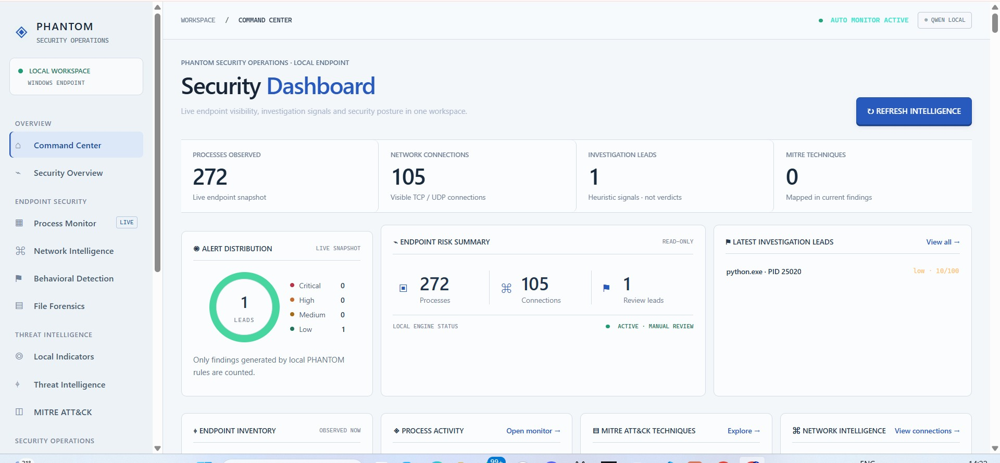
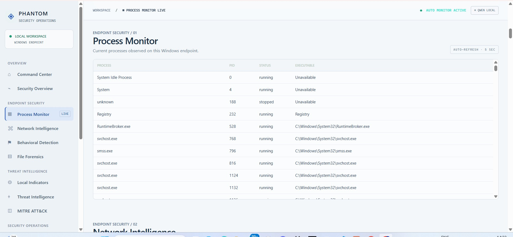
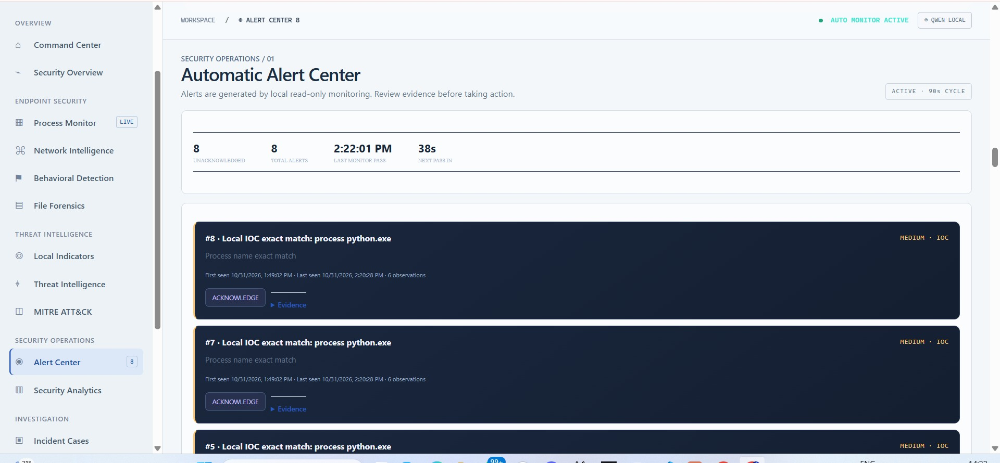
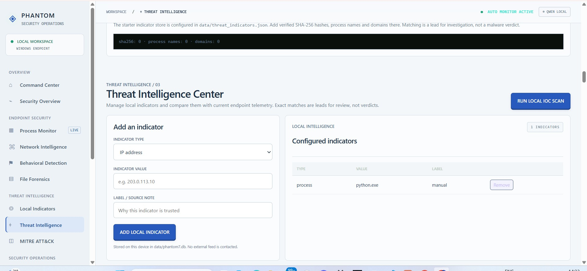

# PHANTOM — Local-First Endpoint Security & Investigation

**PHANTOM** is a Windows-focused, local-first endpoint security monitoring and investigation prototype. It combines read-only endpoint visibility, transparent behavioural heuristics, local indicator matching, persistent security alerts, incident tracking, evidence correlation, and optional AI-assisted analysis through Ollama.

> **Project status:** Hackathon prototype / MVP. PHANTOM is not a certified EDR or antivirus product, and it is not a replacement for Windows Defender or an enterprise SOC. Detection signals are investigative leads—not proof of compromise.

## Capabilities

### Endpoint visibility
- Collects read-only process snapshots.
- Displays visible TCP/UDP connection metadata.
- Provides process and network views for local investigation.
- Calculates SHA-256 hashes and queries Windows Authenticode signature information for selected files.

### Behavioural detection
- Applies local, explainable heuristic rules to endpoint telemetry.
- Provides severity, scores, reasons and available MITRE ATT&CK mappings.
- Treats heuristic matches as leads requiring analyst review.

### Local threat intelligence
- Maintains a SQLite-backed IOC register for IP addresses, domains, SHA-256 hashes and process names.
- Performs exact local matches against supported process, executable-hash and remote-IP telemetry.
- Shows match evidence and scan results.

**Current IOC limitations:** Domain indicators can be stored but are not matched because DNS query telemetry is not currently collected. SHA-256 checks are bounded to accessible executable files up to 100 MB. IOC matches do not establish that a process, file or address is malicious.

### Automated monitoring and alerting
- Starts a background, read-only monitor when the FastAPI application starts.
- Runs behavioural monitoring on a 90-second cycle and IOC checks on a 300-second interval.
- Persists alert records, first-seen/last-seen timestamps and occurrence counts.
- Supports alert acknowledgement and monitoring-health status.
- Creates incident cases automatically for high/critical behavioural findings when the monitor can create the case.

Run PHANTOM with **one Uvicorn worker**: the monitoring loop is process-local and is not designed to coordinate multiple worker processes. The monitor runs while the PHANTOM server is running; Windows service/startup registration is not included.

### Incidents and evidence intelligence
- Creates investigation cases and tracks their status.
- Combines available alerts, incident records and recent security events into an evidence view.
- Exports JSON and HTML investigation reports.
- Correlates alerts to incidents using available IDs and evidence fields. Correlation is an investigative aid, not proof of causation.

### Local AI investigation
- Optionally sends a bounded evidence context to a local Ollama model (demonstrated with `qwen2.5:3b`).
- Produces advisory explanations and suggested read-only next checks.
- Does not make authoritative malware verdicts.
- AI analysis requires Ollama to be installed, running, and the model to be available. Monitoring and report features can operate without AI.

## Architecture

```text
Windows endpoint
    |
    +-- Process / network snapshots (psutil)
    |
    +-- Behavioural heuristic engine
    |
    +-- Local IOC register and exact matching
    |
    +-- Background monitor
    |       +-- Alert store (SQLite)
    |       +-- Monitoring run history
    |
    +-- Incident store (SQLite)
    |
    +-- Evidence correlation and report assembly
    |
    +-- Optional local Ollama / Qwen analysis
    |
FastAPI + HTML/CSS/JavaScript dashboard
    |
127.0.0.1:8000 (local browser)
```

### Main technologies
- Python, FastAPI and Uvicorn
- psutil for read-only endpoint telemetry
- SQLite for local state, alerts, incidents and history
- Ollama with Qwen 2.5 3B for optional local AI
- HTML, CSS and vanilla JavaScript for the dashboard

## Requirements

- Windows 10/11 (developed and demonstrated on Windows 11)
- Python 3.10 or newer
- PowerShell
- Optional: [Ollama for Windows](https://ollama.com/download/windows)

## Installation

Open PowerShell in the cloned project directory:

```powershell
py -3 -m venv .venv
Set-ExecutionPolicy -Scope Process -ExecutionPolicy Bypass -Force
.\.venv\Scripts\Activate.ps1
python -m pip install --upgrade pip
pip install -r requirements.txt
```

If PowerShell activation is restricted, invoke the virtual-environment interpreter directly:

```powershell
.\.venv\Scripts\python.exe -m pip install -r requirements.txt
```

### Optional local AI setup

Install Ollama, then pull the model:

```powershell
ollama pull qwen2.5:3b
```

Keep Ollama running. The first request can take longer while the model loads.

## Run PHANTOM

From the project directory:

```powershell
.\.venv\Scripts\python.exe -m uvicorn app.main:app --host 127.0.0.1 --port 8000
```

Open [http://127.0.0.1:8000](http://127.0.0.1:8000).

Stop the server with `Ctrl+C`. Use one worker so the in-process background monitor is not duplicated.

## Suggested demo flow

1. Open the Command Center and show live process/network visibility.
2. Open Behavioural Detection and review the evidence behind any heuristic finding.
3. Open Threat Intelligence and add a **known test indicator**. Run a local IOC scan and show the exact match.
4. Open Alert Center and demonstrate alert timestamps, occurrence counts and acknowledgement.
5. Open Incident Cases and create/update a test case.
6. Open Evidence Intelligence to review alert/case/event context.
7. Download a JSON or HTML report.
8. With Ollama running, submit a question to the AI Evidence Analyst and explain that its output is advisory.

**Demo hygiene:** Remove test IOCs after the demonstration. A generic process name such as `python.exe` is a poor production IOC and can generate false positives.

## Safety, privacy and operating boundaries

- Core monitoring is designed to be read-only.
- PHANTOM does not automatically terminate processes, delete files, quarantine files, or modify firewall settings.
- The default server command binds to `127.0.0.1`, keeping the dashboard on the local machine.
- SQLite databases and endpoint telemetry are stored locally under `data/`.
- AI analysis uses a local Ollama service when configured; do not expose that service or the dashboard to untrusted networks.
- Do not commit `.env`, `.venv/`, local databases, logs, exported reports containing endpoint details, or other private machine data.
- Run with the minimum permissions needed. Some process/network details may be unavailable without elevated privileges.

## Known limitations

- Windows-specific Authenticode inspection and some telemetry behaviour may vary by OS and permissions.
- Process/network snapshots are not a complete ETW/Sysmon telemetry pipeline.
- DNS query telemetry, full domain reputation checks, external threat-feed synchronisation and cloud reputation are not implemented.
- Alert deduplication is based on stable signal fingerprints; validate behaviour against your own workload and test indicators.
- The monitor runs within the FastAPI process and stops when that process stops. No Windows service or startup task is installed by this repository.
- Evidence correlations are based on currently collected fields and may miss relationships or suggest coincidental links.
- Local AI can be slow on CPU-only hardware and can produce inaccurate explanations. Verify claims against raw evidence.
- This prototype has not undergone independent security audit, penetration testing, or production-scale reliability testing.

## Repository layout

```text
PHANTOM/
├── app/
│   ├── static/          # Dashboard UI
│   ├── main.py          # FastAPI application and routes
│   ├── detection_engine.py
│   ├── phantom7.py      # Local IOC and incident logic
│   ├── phantom8.py      # Background monitor and alert store
│   └── phantom9.py      # Evidence correlation
├── data/
│   └── threat_indicators.json
├── .env.example
├── .gitignore
└── requirements.txt
```

## Hallmark design inspiration

The interface redesign is an original PHANTOM adaptation informed by the design principles in [Nutlope/Hallmark](https://github.com/Nutlope/hallmark), which is MIT-licensed. PHANTOM does not bundle Hallmark's scripts or theme files.


## PHANTOM in Action

The following screenshots show the application running on a Windows endpoint.

### Command Center


### Live Process Monitor


### Automatic Alert Center


### Threat Intelligence Center


> Note: The Python process-name IOC shown in the test screenshots is a demonstration indicator, not a confirmed malware detection.


## License

PHANTOM is licensed under the MIT License.
See the [LICENSE](LICENSE) file for details.
